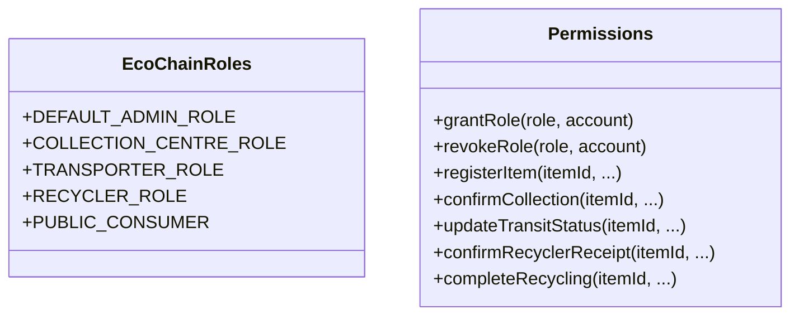
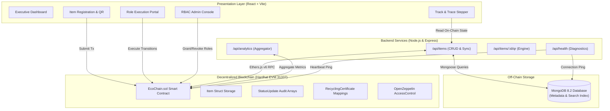
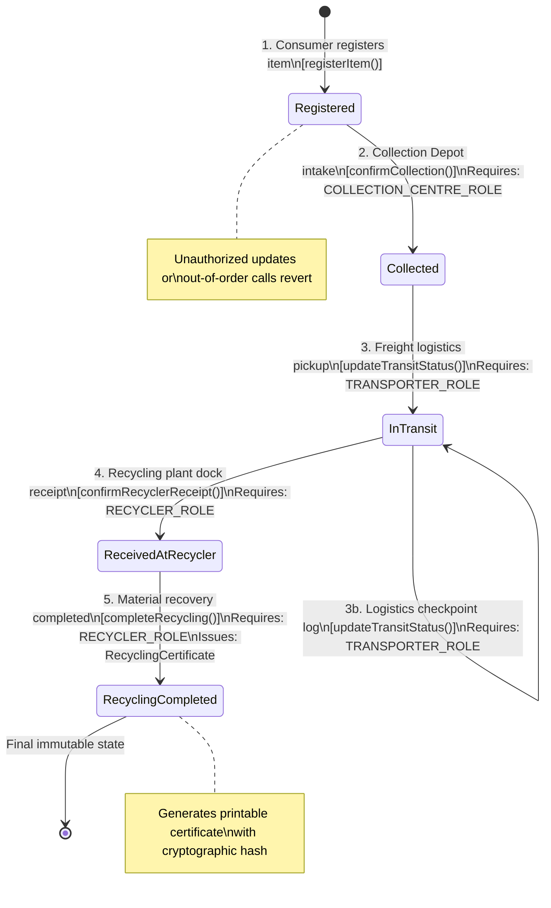

# EcoChain: Blockchain-Based E-Waste Traceability and Recycling Verification System
**Course:** Blockchain Technology (BCT) Capstone Project  
**Academic Year:** 2026  
**Document Classification:** Academic Case Study & Technical Architecture Report  

---

## 1. Abstract
The exponential accumulation of electrical and electronic equipment waste (e-waste) represents one of the fastest-growing environmental and public health crises globally. Traditional e-waste recycling supply chains are plagued by opaque operations, fraudulent greenwashing, unauthorized scrap dumping in developing nations, and an absence of immutable chain-of-custody documentation. 

This paper presents **EcoChain**, an end-to-end decentralized application (DApp) that establishes cryptographic traceability and tamper-proof verification for electronic waste across its entire lifecycle. Utilizing Ethereum-compatible Solidity smart contracts, an EVM-based state machine, OpenZeppelin Role-Based Access Control (RBAC), and cryptographic QR identification passports, EcoChain enforces verifiable transitions across five discrete states: *Registered*, *Collected*, *InTransit*, *ReceivedAtRecycler*, and *RecyclingCompleted*. A Node.js and Express backend combined with MongoDB provides performant query caching and off-chain document synchronization, while a modern React and Vite single-page application equips consumers, collection depots, transit carriers, licensed recyclers, and regulatory auditors with specialized role interfaces. We validate the system through a comprehensive automated test suite (19 passing unit tests) and a local development node deployment, demonstrating guaranteed non-repudiation, elimination of duplicate intake fraud, and automated generation of verifiable Recycling Certificates mapped directly to United Nations Sustainable Development Goals (SDG 12, 13, and 9).

---

## 2. Introduction
According to the United Nations Global E-waste Monitor, over 62 million metric tonnes of electronic waste were generated globally in 2024, a figure projected to exceed 82 million tonnes by 2030. Electronic devices contain high concentrations of hazardous constituents—such as lead, mercury, cadmium, and brominated flame retardants—alongside valuable secondary raw materials including gold, silver, copper, and platinum group metals.

Despite rigorous environmental mandates such as the European Union's Waste from Electrical and Electronic Equipment (WEEE) Directive and Extended Producer Responsibility (EPR) regulations in Asia and the Americas, formal collection and recycling rates hover beneath 23%. A significant percentage of discarded electronics is diverted into unregulated informal recycling or illegal cross-border shipments, resulting in toxic heavy-metal contamination of groundwater and loss of critical strategic materials.

The fundamental impediment to circular electronics economy adoption is the **traceability and trust deficit**. Centralized databases maintained by private waste brokers or municipal authorities are vulnerable to database record alteration, double-counting of recycled quotas, fabricated green compliance certificates, and siloed visibility between logistics carriers and metallurgical refining facilities.

---

## 3. Problem Statement & Objectives

### 3.1 Problem Statement
Contemporary e-waste management systems suffer from:
1. **Lack of Provenance and Chain-of-Custody:** Physical e-waste custody changes multiple times between initial consumer drop-off, collection consolidation hubs, freight transporters, and terminal recycling plants without an immutable, shared single source of truth.
2. **Fraudulent Recycling & Greenwashing:** Dishonest handlers report disposal or recovery numbers to claim tax credits and subsidies without completing metallurgical processing, or they export scrap to informal yards that employ open-air burning and acid leaching.
3. **Double-Counting and Identity Spoofing:** Paper receipts and centralized SQL database entries can be duplicated, allowing multiple recyclers to claim compliance credits for the identical physical batch of scrapped devices.
4. **Disjointed Verification:** Consumers who dispose of electronics have zero visibility into whether their equipment was recycled responsibly or dumped in a landfill.

### 3.2 Objectives
The primary objectives of the EcoChain project are:
- To design and deploy a Solidity smart contract that serves as the definitive, immutable source of truth for all e-waste lifecycle status updates.
- To implement cryptographic Role-Based Access Control (RBAC) preventing unauthorized actors from falsifying supply-chain events.
- To enforce a deterministic, sequential state machine that programmatically rejects out-of-order state transitions (e.g., preventing an item from jumping directly from registration to recycling completion without verified collection and transit).
- To equip physical devices with dynamic cryptographic QR code identifiers that bridge physical hardware to blockchain ledger entries.
- To issue tamper-proof digital Recycling Certificates detailing secondary material recovery metrics and hazardous neutralization references.
- To provide a production-ready full-stack architecture combining Hardhat, Ethers.js, Express, MongoDB, and React with responsive ergonomics.

---

## 4. Limitations of Existing Systems
Centralized enterprise waste-management software and government compliance registries present critical systemic flaws:

| Dimension | Legacy Centralized Systems | EcoChain Decentralized System |
| :--- | :--- | :--- |
| **Data Integrity** | Centralized database administrator can modify or erase logs retrospectively. | Cryptographically immutable distributed ledger; historical states cannot be overwritten. |
| **Single Point of Failure** | Database server outages or corrupted cloud storage halt auditing. | Distributed peer-to-peer EVM node consensus eliminates single points of failure. |
| **Trust Model** | Requires blind trust in private waste brokers and proprietary internal databases. | Trustless verification: math and cryptographic signatures enforce truth. |
| **Access Control** | Vulnerable application-layer session tokens (JWT) susceptible to SQL injection. | On-chain cryptographic keys (`msg.sender`) enforced by EVM bytecode instructions. |
| **Audit Friction** | Manual reconciliation of fragmented paper manifests and carrier spreadsheets. | Real-time, instant block-by-block audit trail accessible via web interface or QR code. |
| **Certificate Verification** | Easily forged static PDF files without digital signatures. | Programmatic on-chain certificates linked to transaction hashes and block timestamps. |

---

## 5. Why Blockchain is Appropriate
Blockchain is not merely a database; it is a distributed, adversarial state machine. The e-waste reverse-supply chain inherently involves multiple competing stakeholders who do not inherently trust one another: consumers, independent municipal depots, third-party logistics carriers, commercial recyclers, and government environmental regulators.

The technical justification for employing blockchain includes:
1. **Byzantine Fault Tolerance and Non-Repudiation:** Every action—such as confirming collection or recording logistics handoff—must be signed by the private key of an authorized account. Signatures are immutably preserved in transaction receipts (`receipt.hash`), establishing incontrovertible legal and regulatory non-repudiation.
2. **Deterministic State Transition Guarantees:** Smart contract validation assertions (`require(...)`) guarantee that invalid operational states cannot be entered into the ledger regardless of client-side errors or malicious API requests.
3. **Decentralized Event Streaming:** EVM event emissions (`emit StatusUpdated(...)`) provide a real-time, tamper-proof pub/sub bus for enterprise resource planning (ERP) integration without maintaining fragile custom webhook clusters.
4. **Anti-Duplication (Double-Spend Analogy):** Just as a blockchain prevents double-spending a digital coin, EcoChain's contract guarantees that an item ID cannot be registered twice, and a Recycling Certificate can only be issued once per physical item.

---

## 6. Proposed Solution Architecture
EcoChain is architected as a layered 4-tier decentralized application:

```
┌────────────────────────────────────────────────────────────────────────┐
│                          PRESENTATION LAYER                            │
│           React 18 + Vite SPA | Lucide Icons | Responsive CSS          │
│   [Dashboard]  [Registration]  [Track & Trace]  [RBAC Actions]  [Cert] │
└────────────────────────────────────┬───────────────────────────────────┘
                                     │ RPC & REST (JSON)
                                     ▼
┌────────────────────────────────────┬───────────────────────────────────┐
│                           APPLICATION TIER                             │
│                  Node.js + Express 4.19 REST API                       │
│    - E-Waste Metadata Serialization     - Dynamic QR Passport Engine   │
│    - Blockchain Health Monitoring       - Multi-node Fallback Router   │
└──────────────────┬─────────────────┴───────────────────┬───────────────┘
                   │ Mongoose ODM                        │ Ethers.js v6
                   ▼                                     ▼
┌────────────────────────────────────┐ ┌─────────────────────────────────┐
│         PERSISTENCE LAYER          │ │        BLOCKCHAIN LAYER         │
│           MongoDB Server           │ │      EVM Localhost / Hardhat    │
│  - Off-chain Document Metadata     │ │  - Smart Contract (EcoChain)   │
│  - Hazardous Material Categories   │ │  - OpenZeppelin RBAC Bytecode   │
│  - High-speed Full-Text Search     │ │  - Immutable Event Logs & State │
└────────────────────────────────────┘ └─────────────────────────────────┘
```

1. **Presentation Layer (Frontend):** React 18 single-page app bundled with Vite. Includes an innovative dual-mode Web3 provider: users can either connect their browser MetaMask wallet or select from pre-authorized demonstration role accounts (Administrator, Collection Depot, Transporter, Recycler, Consumer) with a single click.
2. **Application Tier (Backend):** Express server serving REST endpoints, compiling statistical aggregates, and dynamically generating high-resolution QR codes encoded with lookup verification URLs.
3. **Persistence Layer (Off-Chain Cache):** MongoDB instance running on `localhost:27017`. Used exclusively for caching non-sensitive supplemental metadata (such as photo URLs, categorical search tags, and valuation estimates) without cluttering high-cost blockchain storage.
4. **Blockchain Layer (Source of Truth):** Solidity smart contract deployed to Hardhat EVM (Chain ID 31337). All status updates, actor addresses, timestamps, and certification credentials execute on-chain.

---

## 7. Users and Roles (Role-Based Access Control)
EcoChain implements strict role separation matching real-world reverse-logistics supply chain obligations:



1. **Administrator (`DEFAULT_ADMIN_ROLE`):**
   - Typically held by the environmental protection agency or municipal consortium.
   - Authorizes new collection depots, freight operators, and recycling plants.
   - Has authority to revoke credentials if an organization fails an environmental audit.
2. **Consumer / Originator (Public):**
   - Any citizen, business, or electronics enterprise.
   - Can register end-of-life devices into the ledger.
   - Obtains an immutable cryptographic QR passport and retains read-only tracking privileges.
3. **Collection Centre (`COLLECTION_CENTRE_ROLE`):**
   - Authorized intake depots and municipal drop-off kiosks.
   - Confirms physical possession and intake inspection of registered devices.
4. **Transporter (`TRANSPORTER_ROLE`):**
   - Certified logistics and freight providers.
   - Records chain-of-custody transfer from depot to vehicle and logs transit checkpoints.
5. **Recycler (`RECYCLER_ROLE`):**
   - Certified processing facilities equipped for dismantling, shredding, and chemical recovery.
   - Confirms physical dock arrival.
   - Reports recycling completion, logs secondary materials extracted (in grams), logs hazardous waste neutralization references, and issues the official Recycling Certificate.

---

## 8. System Architecture Diagram



---

## 9. Workflow and Lifecycle State Transition Diagram
The smart contract models a strict, unidirectional finite state machine (FSM). Unauthorized skips or reversed transitions revert with explicit error signatures:



---

## 10. Smart-Contract Design and Code Explanation

### 10.1 Key Data Structures (`EcoChain.sol`)
The contract is implemented using Solidity `^0.8.20` with the `viaIR` optimizer enabled:

```solidity
enum LifecycleStatus {
    Registered,          // 0: Logged by consumer
    Collected,           // 1: Accepted by authorized depot
    InTransit,           // 2: In custody of certified carrier
    ReceivedAtRecycler,  // 3: Logged at processing plant
    RecyclingCompleted   // 4: Materials recovered & certified
}

struct Item {
    string itemId;
    string itemType;
    string brandModel;
    uint256 weightGrams;
    string serialNumber;
    address registeredBy;
    uint256 registrationTimestamp;
    LifecycleStatus currentStatus;
    bool exists;
}

struct StatusUpdate {
    LifecycleStatus status;
    address updatedBy;
    string updaterRole;
    uint256 timestamp;
    string location;
    string remarks;
}

struct RecyclingCertificate {
    string certificateId;
    string itemId;
    uint256 completionTimestamp;
    address recyclerAddress;
    string recyclingFacility;
    string recoveryMethod;
    uint256 recoveredMaterialsWeightGrams;
    string hazardousWasteDisposalRef;
    string remarks;
    bool issued;
}
```

### 10.2 Role-Based Security Modifiers
Privileged functions are guarded using OpenZeppelin's `onlyRole(bytes32 role)` modifier:
- `COLLECTION_CENTRE_ROLE = keccak256("COLLECTION_CENTRE_ROLE")`
- `TRANSPORTER_ROLE = keccak256("TRANSPORTER_ROLE")`
- `RECYCLER_ROLE = keccak256("RECYCLER_ROLE")`
- `DEFAULT_ADMIN_ROLE = 0x00` (deployer root administrator)

### 10.3 State Transition Logic & Reentrancy Guards
All state-modifying functions inherit OpenZeppelin's `ReentrancyGuard` and employ `nonReentrant` modifiers to guarantee execution safety against re-entrancy vectors. Every function verifies that:
1. The target item ID exists: `require(items[itemId].exists, "EcoChain: Item does not exist");`
2. The item is in the exact prerequisite state:
   ```solidity
   require(
       items[itemId].currentStatus == LifecycleStatus.ReceivedAtRecycler,
       "EcoChain: Invalid status transition. Item must be 'ReceivedAtRecycler'"
   );
   ```
3. A certificate has not already been generated for this item ID, preventing duplicate credit claims.

---

## 11. Implementation and Setup Instructions

### 11.1 Prerequisites
- **Operating System:** Windows 10/11, macOS, or Ubuntu Linux
- **Node.js:** v18.x to v24.x (v24.11.1 validated)
- **NPM:** v10.x to v11.x (v11.6.2 validated)
- **MongoDB:** v6.x to v8.x (v8.2.1 validated running on default port 27017)

### 11.2 Installation Steps
Clone or open the workspace repository:
```powershell
cd c:\BCT
```

1. **Install Blockchain Dependencies:**
   ```powershell
   cd blockchain
   npm install
   ```

2. **Install Backend Dependencies:**
   ```powershell
   cd ..\backend
   npm install
   ```

3. **Install Frontend Dependencies:**
   ```powershell
   cd ..\frontend
   npm install
   ```

### 11.3 Deployment & Execution Sequence
Run the components in separate terminal windows:

- **Terminal 1: Start Hardhat EVM Node**
  ```powershell
  cd c:\BCT\blockchain
  npx hardhat node
  ```
  *Node starts at `http://127.0.0.1:8545` with 20 pre-funded test accounts.*

- **Terminal 2: Deploy Contract and Seed Demo Data**
  ```powershell
  cd c:\BCT\blockchain
  npx hardhat run scripts/deploy.js --network localhost
  ```
  *Outputs deployed contract address `0x5FbDB2315678afecb367f032d93F642f64180aa3` and saves deployment artifact to `c:\BCT\shared\contract-deployment.json`.*

- **Terminal 3: Start Backend API Service**
  ```powershell
  cd c:\BCT\backend
  npm start
  ```
  *Express API starts at `http://localhost:5000` connected to MongoDB and Hardhat.*

- **Terminal 4: Start Frontend Development Server**
  ```powershell
  cd c:\BCT\frontend
  npm run dev
  ```
  *Vite application opens at `http://localhost:5173`.*

---

## 12. Testing Methodology and Actual Results

### 12.1 Testing Suite Architecture
Testing was implemented via Hardhat and Mocha/Chai matchers (`blockchain/test/EcoChain.test.js`). The suite tests both positive validation paths and negative failure paths (unauthorized callers and invalid state sequences).

### 12.2 Actual Executed Test Results (19/19 Passing)

| Test Suite Module | Test Description | Expected Result | Actual Result |
| :--- | :--- | :--- | :--- |
| **1. Deployment & Access Control** | Deployer assigned `DEFAULT_ADMIN_ROLE` | Admin holds role 0x00 | **PASS (√)** |
| | Pre-assigned roles allocated to accounts 1, 2, 3 | Roles verified via `hasRole()` | **PASS (√)** |
| | Admin can revoke and re-grant roles | Role updated dynamically | **PASS (√)** |
| | Non-admin attempting `grantRole()` is rejected | Reverts with `AccessControlUnauthorizedAccount` | **PASS (√)** |
| | Helper function `checkUserRoles()` accurately checks privileges | Returns accurate boolean tuple | **PASS (√)** |
| **2. Item Registration** | Consumer registers new e-waste item | Emits `ItemRegistered`, status = 0 | **PASS (√)** |
| | Rejects duplicate item ID registration | Reverts with `"EcoChain: Item ID already exists"` | **PASS (√)** |
| | Rejects empty ID or empty item category | Reverts with explicit validation strings | **PASS (√)** |
| **3. Lifecycle Transitions & RBAC** | Authorized collection centre confirms collection | Transitions status 0 → 1, emits event | **PASS (√)** |
| | Unauthorized account attempting collection confirmation | Reverts with `AccessControlUnauthorizedAccount` | **PASS (√)** |
| | Transporter cannot jump ahead before collection | Reverts with `"Invalid status transition"` | **PASS (√)** |
| | Transporter updates status after collection | Transitions status 1 → 2, logs checkpoints | **PASS (√)** |
| | Recycler cannot confirm receipt before transit | Reverts with `"Invalid status transition"` | **PASS (√)** |
| | Recycler confirms receipt when InTransit | Transitions status 2 → 3 | **PASS (√)** |
| **4. Recycling Completion & Cert** | Recycler completes recycling and issues certificate | Transitions status 3 → 4, emits certificate | **PASS (√)** |
| | Rejects duplicate certificate issuance on same item | Reverts with `"Invalid status transition"` | **PASS (√)** |
| | Unauthorized consumer cannot complete recycling | Reverts with `AccessControlUnauthorizedAccount` | **PASS (√)** |
| **5. Audit History & Queries** | Maintains chronological audit array matching all steps | Returns full 5-event audit trail | **PASS (√)** |
| | Reverts when querying non-existent item or certificate | Reverts with `"EcoChain: Item not found"` | **PASS (√)** |

**Summary:** 19 passing (execution duration: 2 seconds, 0 failures).

---

## 13. System Benefits & Real-World Impact
1. **Elimination of Counterfeit Recycling:** Waste brokers cannot claim subsidies or carbon offsets without cryptographic proof of receipt and destruction from a certified recycling address.
2. **Citizen Empowerment:** Consumers obtain instant feedback regarding the fate of their discarded electronics by scanning the item's QR code.
3. **Regulatory Streamlining:** Environmental agencies can monitor regional recycling quotas in real time via read-only smart-contract queries rather than conducting annual paper audits.
4. **Enhanced Secondary Market Value:** Manufacturers purchasing recycled metals obtain provable chain-of-origin documentation, enabling compliance with upcoming EU Digital Product Passport (DPP) regulations.

---

## 14. Limitations and Future Enhancements

### 14.1 Limitations
- **The Physical-to-Digital Oracle Gap:** A blockchain ensures that recorded transactions are immutable; however, it cannot independently verify that physical scrap delivered to a plant matches the exact serial number entered on-chain without automated hardware scanning.
- **Gas Costs on Public Mainnet:** Executing every transit checkpoint on Ethereum Layer 1 would incur prohibitive transaction fees (gas). EcoChain is optimized for Ethereum Layer 2 rollups (e.g., Arbitrum, Optimism, or Polygon PoS).

### 14.2 Future Enhancements
1. **IoT Sensor & GPS Telematics Integration:** Equipping transport containers with automated GPS transponders and smart seals that trigger transit checkpoint transactions via Chainlink decentralized oracles.
2. **Zero-Knowledge Proofs (zk-SNARKs):** Enabling competing recyclers to verify compliance and material purity without disclosing proprietary chemical extraction recipes or trade secrets.
3. **Decentralized Storage (IPFS/Filecoin):** Migrating item teardown images and detailed hazardous waste manifest PDFs to IPFS, storing content hashes (`Qm...`) on-chain.

---

## 15. UN Sustainable Development Goals (SDG) Alignment
EcoChain directly advances three primary United Nations Sustainable Development Goals:

```
┌────────────────────────────────────────────────────────────────────────┐
│                        UN SDG IMPACT MATRIX                            │
├────────────────────────────────────────────────────────────────────────┤
│ SDG 12: Responsible Consumption and Production                         │
│ - Target 12.4: Environmentally sound management of chemicals and       │
│   hazardous e-waste throughout their lifecycle.                        │
│ - Target 12.5: Substantially reduce waste generation through           │
│   prevention, reduction, recycling, and reuse.                         │
├────────────────────────────────────────────────────────────────────────┤
│ SDG 13: Climate Action                                                 │
│ - Target 13.2: Integrate climate change measures and circular economy   │
│   metrics into national policies, recovering secondary metals to       │
│   displace virgin mining emissions (1.44 kg CO2 saved per kg recycled).│
├────────────────────────────────────────────────────────────────────────┤
│ SDG 9: Industry, Innovation, and Infrastructure                        │
│ - Target 9.4: Upgrade infrastructure and retrofit industries to make   │
│   e-waste logistics transparent, resource-efficient, and sustainable.  │
└────────────────────────────────────────────────────────────────────────┘
```

---

## 16. References
1. Forti, V., Baldé, C. P., Kuehr, R., & Bel, G. (2024). *The Global E-waste Monitor 2024: Quantities, flows, and the circular economy potential*. United Nations University (UNU) / International Telecommunication Union (ITU).
2. European Parliament and Council. (2012). *Directive 2012/19/EU on waste electrical and electronic equipment (WEEE)*. Official Journal of the European Union.
3. Wood, G. (2014). *Ethereum: A secure decentralised generalised transaction ledger*. Ethereum Project Yellow Paper.
4. OpenZeppelin. (2024). *AccessControl: Role-Based Access Control in Solidity*. OpenZeppelin Contracts Documentation.
5. Antonopoulos, A. M., & Wood, G. (2018). *Mastering Ethereum: Building Smart Contracts and DApps*. O'Reilly Media.
6. Saberi, S., Kouhizadeh, M., Sarkis, J., & Shen, L. (2019). *Blockchain technology and its relationships to sustainable supply chain management*. International Journal of Production Research, 57(7), 2117-2135.
7. United Nations Department of Economic and Social Affairs. (2015). *Transforming our world: the 2030 Agenda for Sustainable Development*. UN Publishing.
